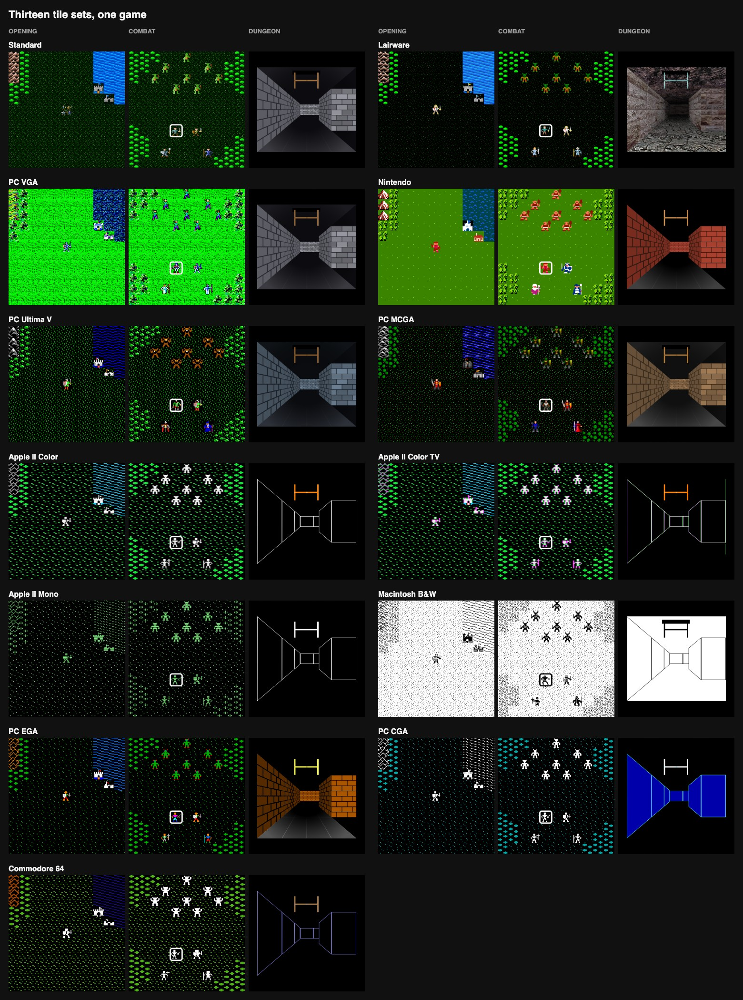

# Ultima III: Exodus

*A modernized port of the original game. Both historic and modern play,
for the browser, Windows, macOS, Linux, Android and the Steam Deck.*

**Play it:** <https://synthwave-pixel.github.io/ultima3/>

Background: I played Ultima III on both my Apple //c and my Nintendo, and
then Ultima V on my Apple //gs. Later I rediscovered the game via the
LairWare macOS port.

I am pleased to offer an updated version of the title with quite a few
changes:

1. Rebuilt in TypeScript. Runs in the browser, installs as an offline PWA,
   and ships as macOS, Windows, Linux and Android builds.
2. Still offers an experience very close to the original if you choose,
   building on the LairWare baseline with its full set of period tile
   sets: Apple II in color and mono, Commodore 64, NES, the PC's CGA,
   EGA, MCGA and VGA, the Ultima V look and the Macintosh black on
   white.
3. Includes an updated Standard experience: controller play, new art and
   sound, and tweakable settings.

The following were design principles for the updated Standard experience:

1. No changes to the core data files - it's Ultima III.
2. Changes are all made with the spirit and look of the original, with
   just enough updates to allow a new player to enjoy the game completely
   offline and have a great time.

The game starts in the new Controller mode, inspired by the NES version,
which most modern players will prefer. In Controller mode the whole game
is played using simple, in-game controls and menus.

This controller user experience works as well with a keyboard as with a
gamepad or a touch screen, and is far more accessible on a desktop than
typing letters. Menus put the common actions at the top, and a few
shortcuts (cast the right heal, open a chest safely, light a dungeon) make
combat and exploration more fun - it's still grindy, but now the grind is
*fun*. Everything is designed to look like it could have been in the
original, while still bringing a more modern UX design to the table.

A map fills in as the party explores, and a quest
journal gives just enough in-game hints that most players should be able
to finish the game without an external guide. There are options that ease
the difficulty a little. The party shares one inventory for unequipped
gear. And many, many other subtle improvements.

All of it is configurable in the game's Pause menu. If you want the original
gameplay, it is all still there: classic difficulty, keyboard commands,
the original skins. Not a single data file from the original LairWare
build has been touched.

Ultima III is by Richard Garriott and Origin Systems (1983). The Macintosh
port is by Leon McNeill of LairWare, whose original README is at the
bottom of this page.

## Installation

- **Browser**: <https://synthwave-pixel.github.io/ultima3/>. Nothing to
  install. Chrome, Edge and Android offer to add it as an app, and it
  works offline after the first visit.
- **Steam Deck**: the game installs as a Flatpak from Desktop Mode, in a
  few minutes, and then lives in your Game Mode library.
  1. Switch to Desktop Mode: press the Steam button, choose Power, then
     Switch to Desktop.
  2. If the Deck has never had a password, give it one: open Konsole and
     run `passwd`, choosing any password you like. Discover needs it once,
     when it registers the game's repository, and it is also what `sudo`
     asks for; nothing else changes.
  3. Open this page in a browser there (if the Deck has none yet,
     Discover, its app store, installs Firefox) and tap
     [install Ultima III](https://synthwave-pixel.github.io/ultima3/flatpak/ultima3.flatpakref).
     The browser saves a small file; open it from the browser's downloads
     and Discover shows Ultima III with an Install button, and asks for
     the password that first time. Install once: later updates arrive in
     Discover with every other Flatpak's, with no prompt.
  4. Open Steam, still in Desktop Mode. Click Add a Game at the bottom
     left, then Add a Non-Steam Game, tick Ultima III in the list, and
     click Add Selected Programs.
  5. Return to Game Mode with the icon on the desktop, or restart. The
     game is in your library under Non-Steam. If the controls do not
     respond, open the shortcut's controller settings and pick a Gamepad
     template. The first time you play it from there, the game puts the
     box art in Steam's library (the cover, the banner and the logo),
     which shows once Steam has restarted; artwork you set yourself is
     never replaced.

  The same link works on any Linux desktop with Flatpak, and the
  terminal line at the bottom of this page installs per user with no
  password at all.
- **Windows and macOS**: the installers on the
  [Releases page](https://github.com/synthwave-pixel/ultima3/releases/latest),
  a Windows installer or portable `.exe` and an Apple Silicon `.dmg`
  (macOS 13 or later). They are unsigned; see the Desktop app section
  below for the one-time step each system asks for.
- **Android**: the APK on the Releases page, or
  [Obtainium](https://github.com/ImranR98/Obtainium) to keep it updated;
  see Android handhelds below.
- **Linux without Flatpak**: the `AppImage` on the Releases page.

## Playing

The game runs in any current browser. Chrome, Edge and Android offer to
install it from the address bar or the browser menu; on iOS use Share,
then Add to Home Screen. After the first visit it runs without a network.
Updates download in the background, and the title menu then offers
"Update: restart".

The game saves itself at every town, castle and dungeon door and at Quit,
in the browser's local storage, and resumes on the next visit; the maps
and the journal are saved with it. The title menu's Export game copies
the saved game as text to the clipboard or a file, and Import game reads
it back, which is how a game moves between devices. The [showcase
saves](showcase/README.md) are games ready at some of Sosaria's sights,
from the opening to the castle of Exodus, to import and try (importing
one replaces the game in progress, so export yours first).

**Back up your saved game.** Browsers can clear a site's storage on their
own: Safari and every other iOS browser delete it after seven days without
a visit, and any browser may drop it under storage pressure, when site
data is cleared, or at the end of a private window. Play often, and export
the game now and then so a copy is on the clipboard or in a file. On iOS,
add the game to the Home Screen, which keeps its storage; in a browser tab
the game warns of this once a day. If a browser cannot keep a save at all,
copy and paste alone is enough to carry a game through.

### Desktop app, and the Steam Deck

The same game is packaged as a desktop app with Electron, for players who
want a plain window, an icon in the dock, or a Steam shortcut. Builds for
Windows, macOS and Linux are on the
[Releases page](https://github.com/synthwave-pixel/ultima3/releases). The
desktop app keeps its saved game in its own storage, separate from the
browser's; Export and Import move a game between them. It opens full
screen unless you last left it a window; F11 or Alt+Enter (or macOS's
green button) switches. Its title menu has
a Quit, for a full screen or Steam's Game Mode where the window has no
close button, and only one copy runs at a time: launching it again brings
the open one forward, so two copies never write over each other's save.
When a newer release is out, the title says so once, in a box of its own,
and its menu offers "Update (x.y.z)" from then on; either opens the
release's page to download it. The Flatpak is kept
up to date by Discover or `flatpak update` instead, and nothing is offered
under Steam's Game Mode, where a browser would open over the game.

- **Windows**: an installer and a portable `.exe`. Both are unsigned, so
  SmartScreen asks once; choose More info, then Run anyway. The portable
  `.exe` keeps its saves and settings in an `Ultima III Data` folder
  beside it, so they go wherever it is carried; the installed game keeps
  them in `%APPDATA%\Ultima III`.
- **macOS**: an Apple Silicon `.dmg`, for macOS 13 (Ventura) or later
  (Intel Macs: use the web version). Signed by no Apple developer, so the
  first launch is refused. Try to open the app once, then open System
  Settings, choose Privacy & Security, scroll down to Security and click
  Open Anyway beside Ultima III; it opens normally from then on. Or, in
  Terminal, once: `xattr -dr com.apple.quarantine "/Applications/Ultima III.app"`.
  If macOS later asks to let Ultima III use the microphone (it can when
  the sound plays through a USB microphone or a headset), choose Don't
  Allow: the game never uses it, and the sound plays on.

  

- **Linux and SteamOS**: the Flatpak repository, installed as under
  Installation above, is the way on a Steam Deck and on any Linux with
  Flatpak: one click or one line, and updates arrive with every other
  Flatpak's. Add the game to Steam from the Non-Steam Game list, and in
  the shortcut's controller settings pick a Gamepad template. The app
  sees the controller as a gamepad and switches to controller mode on the
  first press, and starts full screen when Steam launches it. In Game
  Mode it also turns off GPU acceleration and the browser sandbox, which
  have hung other Electron apps under gamescope. The `.flatpak` bundle on
  the Releases page is the same build for an offline install
  (`flatpak install --user <file>`, which then never updates), and the
  `AppImage` suits a Linux without Flatpak: make it executable and run it.

### Android handhelds

For Android handhelds like the AYN Odin or the Retroid Pocket, and for
phones and tablets, the same workflow also builds an APK
(`Ultima-III-<version>-android.apk`), published in the same release as
the desktop installers. Copy it to the device and open it; Android asks
once to allow installs from that source. Or let
[Obtainium](https://github.com/ImranR98/Obtainium) install it and keep it
updated from the releases: tap the badge on the device, or add
`https://github.com/synthwave-pixel/ultima3` in Obtainium by hand.

The app runs full screen in landscape, the Back button opens the Pause
menu as Escape does, the title menu ends with Quit to close the app, and
built-in controls that Android reports as a gamepad switch the game to
controller mode on the first press. When a newer release is out, the title
says so once and its menu offers "Update (x.y.z)", which opens its page
(Obtainium, where it installed the app, finds it too). The APK is signed
with a key kept in the repository, so a new build installs over the old
one and keeps the saved game. iOS has no such build on purpose: install
the web version from Safari's Share menu with Add to Home Screen instead.

### Controller mode

The default; a gamepad button press also switches back to it from keyboard
mode. A tap on a touch screen shows a virtual controller, sized to an NES
pad on any screen. Holding a direction, on a gamepad or the virtual pad,
keeps walking as a held key does.

    D-pad   move, or move the cursor in a menu
    A       open the command menu; choose
    B       cancel, or pass a turn (so the menu has no Pass)
    X       ztats
    Y       look; attack in combat; ignite a torch in dungeons
    View    open the Pause menu, which stops the game
    Menu    the same; either system button pauses

On a keyboard the stand-ins are WASD or the arrows for the d-pad, Enter or
Z for A, X or B for B, C for X, V or Y for Y, and Escape pauses. On a
touch screen the pause button is at the top of the virtual pad.

### Keyboard mode

For the original feel, chosen under Pause > Gameplay when the menu is
opened with a key press. The Apple II commands, one letter each:

    Arrows       walk; move in combat      Space   pass a turn
    Escape       pause menu                J       journal
    #            the map

    A attack     B board      C cast      E enter     F fire
    G get chest  I ignite     L look      M modify    N negate
    O other      P peer gem   Q quit/save R ready     S steal
    T transact   U unlock     V volume    W wear      X exit craft
    Y yell       Z ztats

    Combat:   arrows move (into a monster attacks), A attack in a
              direction, C N R Z (auto combat is in the Pause menu;
              while it plays, B or Escape takes the fight back)
    Dungeons: up/down advance or retreat, left/right turn, I K D
              ignite, klimb, descend, L change view (first person,
              with a map, top down)
    Shortcuts: ! cast the heal the party needs, @ safe chest, $ light

A "whom" prompt takes a member number, or Up and Down through the stats
boxes and Enter. The same controls are in the game under Pause > Help.

### The Pause menu

A controller's system buttons (View and Menu, either side of the maker's
logo), Escape, or the pause button on the virtual pad stop the game where
it stands: the idle timer, a combat turn's timer and the music all hold
until Resume. A window that loses focus pauses itself and opens the same
menu, which stays up until you close it, so nothing runs on while you are
away.

The menu holds the settings: auto combat, Visuals (the tile set and
scanlines), Gameplay (the input mode, poison kills, starvation, balanced
XP, the turn timer and Battery saver), Audio (Sound FX, Standard,
Lairware or Off, and the FX level, music and the Music level), Tips (how
the game works, for a new player, without the quest's answers), Help,
Cheats, and Quit and save where the game allows it, on the surface and
out of a fight. A new game's first turn points to Tips, once. A level is
a dial, Off or 10% to 100%: each step is heard as it turns, the music
playing under the paused game until the dial closes. The title screen
shows the same settings under Settings, all but Cheats, which want a game
going. The input mode is offered only when the menu was opened with a key
press: keyboard mode wants a keyboard, and choosing it with a thumb or a
gamepad used to leave a player pressing buttons the letter commands
ignore. Every setting is remembered by the browser. A new game asks
"Choose Thine Adventure!": Modern (recommended), Classic (hardcore, the
Apple II's rules) or Story (relaxed), each a preset of the difficulty
settings that can be changed afterwards.

## What changed

### Changes to all modes

These apply whatever tile set and sound set are chosen.

#### Controller mode

- The command menu lists what the surroundings call for first: Enter on a
  town, Board on a horse, Get on a chest, Attack beside a monster. Commands
  that make no sense where you stand are left out, and ones with nothing
  on hand (no gem, no torch, no caster alive) are grayed. What a button
  does is not in it: B passes, and the system buttons open the Pause menu,
  which holds the settings, auto combat, and Quit and save.
- In combat, a ranged weapon in hand puts "Attack (Bow)" first and a
  caster gets "Cast (spell)" with their last spell ready. Walking into a
  foe attacks it.
- The party panel shows what the menu's bar is on, after the Ultima V
  port: on Ztats each member's experience toward the next level, on Ready
  weapon the weapon in hand, on Wear armour the armour worn. In a shop's
  Buy list and in Ready's and Wear's lists a card over the panel weighs
  the item for the member against what they have, green where it is
  better and red where it is worse; in the spell lists, the spell's card
  gives its book name, its cost against the caster's mana and what it
  does.
- Shortcuts cast at once, with no prompts, choosing the caster with the
  most mana: "Cast (Heal)" or "Cast (Great heal)" leads the menu when
  someone is hurt; "Cast (Safe chest)" sits under Get chest on a chest;
  "Cast (Long light)" or "Cast (Light)" sits under Ignite torch in a dark
  dungeon, the strongest light spell anyone can cast.
- Menus replace typed numbers on the title and party screens: the roster
  is a pick list, the party a list in marching order, attributes a screen
  where left and right spend the points, and a random name is offered.
  "Who?" prompts move a pair of arrows through the stats boxes, starting
  on the member the command most likely wants: the nimblest for a chest
  or a theft, the most hurt for a heal, the poisoned, dead or ashes for a
  cure, resurrection or recall, the caster with the most mana for Cast,
  and someone without the mark who can bear its burn for a rod.
- A virtual controller on touch screens, a gamepad through the Gamepad
  API, and an on-screen keyboard for names.

#### Journal, map and hints

- A quest journal, which the Apple II never had, after the Ultima V
  port's. The main quest lists the steps to Exodus: speak to the king, the
  Marks of Kings, Fire and Force, the four cards, exotic arms, the silver
  snake, the order of the cards, Exodus. After the king they may be taken
  in any order, so each is shown once something has told of it, and opens
  to every clue heard about it, as it was spoken - townsfolk, pub rumours
  and the oracle's verses alike. Beside it are the places: Lord British's
  castle and the ten towns, with how many of each one's clues have been
  heard (the towns on isles, and Dawn, a mystery until found or told of);
  the pubs' nine rumours and the oracle's rhyme, each in order as heard;
  the seven dungeons, a mystery until found or told of, with what each
  holds for the quest found; and Ambrosia's four shrines and their cards.
  Then the equipment to go and get: a guild's supplies, the magic weapons
  and armour, a ship, and the moongates come out of; and the words Other
  answers to. A card over the party panel says where the highlighted line
  stands, and H (Y on a controller) prints a hint written for this port.
  "Journal updated" prints when something real changes.
- Words for Other are learnt by hearing them said. On a controller, Other
  offers only the words learnt; a keyboard may type any word, as on the
  Apple II.
- View map (# on a keyboard, or the command menu) shows what the party has
  seen, filled in square by square as it goes, after the Ultima V port's
  map: Sosaria, Ambrosia and each town and castle whole on the screen in
  the tile set's own tiles, and in a dungeon its level's auto-map.
  Sosaria's unexplored land and sea are a chart of its coasts in ink on
  paper; elsewhere the unexplored is dark. Places are marked once seen and
  named once the party has been inside ("Towne?" till then); the towns and
  Lord British's castle are marked from the start, as the box's map had
  them, inked on the chart as "Undiscovered" until seen. The d-pad steps
  between them, A opens the map of a town or castle the party has been in,
  Y comes back to the party and X turns to the next map. Every moongate
  the party has come out of is marked with the moon that opens it, so the
  gate table writes itself one trip at a time. What is on it is what the
  party has had in its line of sight: whatever forest, mountains or walls
  hide stays unknown. It replaces the cloth map from the box. The maps go
  with the saved game. Forming a new party keeps them, so members can come
  and go in one adventure; Clear notes, in Organize a party, forgets them,
  with the journal and the moongates, to begin a new one.
- A dungeon auto-map, the graph paper of old: cells seen by torchlight are
  recorded. L changes the dungeon's view between First person, 1st person
  + map (a 5x5 piece of the level beside the view) and Top down (the level
  in place of the first-person view, which turns the dungeon into a
  top-down crawl). Both maps keep the party in the middle and move the
  level round it, after the Ultima V port's. The levels wrap, as they
  always did, and most were laid out inside one wall that bounds them on
  both sides through the wrap: the maps draw that wall beside the party at
  whichever edge it stands, never on the far side, and run a passage on
  across an edge it crosses; a level that loops right round goes on past
  its edges. View map shows the whole level, still, as a page with the
  rest of the map.

#### Party and inventory

- Gold and food are pooled for the whole party and shown on the top
  border. Members eat from the pool and go hungry together.
- Weapons and armor are pooled in one bag; a member's record keeps only
  what is readied and worn. Ready and Wear draw from the bag, so one sword
  cannot arm two members. Shops gray what the buyer's class cannot use,
  weigh each ware against what the buyer has under the Buy list (a
  weapon's damage a hit and whether it shoots, or how often foes would hit
  in the armor; green where it is better, red where it is worse), and
  offer to ready or wear a purchase on the spot. Forming a party pools the
  bags; dispersing deals them out. The Hand command is gone.
- Gems, keys, powders and torches are the party's too, so Peer, Unlock,
  Negate time and Ignite never ask whose.
- Lord British's raise adds the hundred hit points as well as the room for
  them, and his prompt lists only the members due a level.

#### Difficulty and settings

- Poison kills, off by default: poison stops at one hit point so a member
  limps home; on, it kills as on the Apple II.
- Starvation: Classic (the Apple II's, to the death), Mild (stops at half
  hit points, the default) or None.
- Timer: Fast (the Apple II's turn timer), Slow, or Off, which makes the
  game turn-based through and through. A fight whose turns have passed by
  themselves for a minute, no key pressed, pauses until the player comes
  back.
- Balanced XP, on by default: a kill's experience is shared among the
  living members instead of going all to the killer.
- Battery saver, off by default: a minute after the last press the map
  stops animating, until the next press, for a phone or handheld left
  with the game open. Whatever changes still shows.
- Scanlines, off by default: the look of a CRT over the whole game, in
  any tile set, one line for each of the Apple II's 192 screen lines.
  They are drawn in the screen's own pixels, so they stay even at any
  window size.
- Auto combat, LairWare's addition, kept, with a smarter planner: members
  path round comrades and walls to the nearest square they can strike
  from.

#### Sound

- Two sets of effects, chosen in Settings: Standard, new and described
  under the Standard changes below, and Lairware, the Macintosh port's
  sampled set with a per-effect gain table that evens out its levels. Off
  silences them.
- The same effect is not restarted within a few dozen milliseconds, a long
  one is not restarted while it sounds, and the music dips under a long
  effect.
- The title-screen menus answer each key with an effect from the chosen
  set: a footstep as the cursor moves, the attack for a choice, a swing on
  backing out.

#### Play

- Bumping into things does what you would have typed next: a townsperson
  is talked to, a counter opens the shop, a locked door asks for a key, a
  monster is attacked.
- Transact asks the direction first and "who" only when it matters.
- Backing out of a command with B or Escape, at a direction, a "who" or a
  list, says "Cancelled." and spends no turn, where the Apple II spent it.
  A spell backed out of at its own prompt gets its mana back, and Ztats in
  combat no longer uses up the member's turn.
- Spell menus name spells by what they do (Magic bolt, Heal, Up a level),
  with the book name, cost and effect on the spell's card.
- Other and Yell are one command, and EVOCARE works from either.
- Repeated turns fold together: "North (x5)" instead of five lines.
- Fountains and the *redacted* speak when the party steps onto them, not
  on every turn spent standing there.
- Direction and "who" prompts sit on the map's border so the map and the
  combat marker stay in view. The active member in combat has a fading
  outline instead of a blink.
- A party wipe offers a choice: try again from the last save, or flee to
  Lord British as the Apple II did.
- The game pauses, music included, while the window is not focused.
- Cheats, in the Pause menu: full restore, raise every level, go home,
  exit dungeon, gold, food, gems, keys and torches, and Add word, which
  learns a word for Other early (on a controller, typed on the on-screen
  keyboard). None of it existed in the original; it is there for testing
  and for anyone who wants it.

#### Bug fixes

- Monsters far to the west of the party headed the long way round: the C
  port's heading test did not wrap as the Apple II's 8-bit arithmetic did.
- A new character could throw away their only dagger; now a dagger is
  thrown only when there is a spare.
- A dungeon's trap went off when the party's leader had the knack to
  evade it, and was evaded when they did not: the check ran the wrong way
  round, where the chests' traps have it right. A nimble leader, a thief
  above all, now evades them.
- Steal looked for the chest just past a shop's counter, where the
  merchant stands, so it failed at every counter but one; LairWare's
  looks behind the merchant, where the chests are, and so does this port.
- The last letter of Moon's "CAPESSII" sign was drawn as a door. A door
  and the letter "I" share one map value, and the Mac port decided between
  them by looking at the neighbouring tile, counting another "I" as not a
  letter so that two doors would not vouch for each other. That also
  stranded the second "I" of a double, which saw only its twin. It now
  looks past a run of "I"s, which reads the sign and leaves all thirty
  doors in the game doors. The seven tile sets that draw one picture for
  both never showed it.
- Death Gulch's armoury had a force field running in its east wall, one
  nibble off a wall tile in the map LairWare shipped. The data files are
  still untouched; the tile is corrected as the map loads. The party could
  never reach it, but a force field scrolls, so it flickered over the
  counter. Both of these were reported by Reddit user behindtimes.

#### Left out on purpose

LairWare's Mac additions that were not part of the game: auto-heal, the
LairWare stats dialog, the Diorama map and random map generator,
text-to-speech, mouse control and the Mac dialogs. The Apple II text flow
is used instead. Diagonal movement for the
party, which the Mac allowed, is off: as on the Apple II, monsters may
move diagonally and the party may not. LairWare had some other updates
for things like portraits that are not included.

#### The opening and the demo

The game starts as LairWare's did, in whichever tile set is chosen: the
Exodus logo dissolves in, Lord British signs it, the party fights a dragon
under a cave's roof and burns, and the map of Sosaria plays itself, all to
the combat music. Any key, button, click or tap goes to the title, which
fades into the exploration music, and whose Return to the view plays the
demo again, fading back. In a browser tab the music starts with the first
press. With Battery saver on, the demo runs a minute from the last press
and then gives way to the title.
LairWare's large "Ultima III" picture under the logo is left out, and its
fight, five pictures in one look, is drawn from each tile set's own party,
dragon, fire and lava. Standard's party meets PC Ultima V's dragon and
fire there, under a slate roof in its own grain.

### Changes to the historic modes

Changes that make each of the older tile sets look more like its machine
than the Mac version did.

- Each set paints its own first-person dungeon: wireframe corridors for
  the Apple II, Commodore 64 and Macintosh sets, blue and cyan for CGA,
  flat bricks in each palette for the NES and the EGA, MCGA, VGA and
  Ultima V sets. The Mac drew one photographic dungeon whatever the tiles;
  that pairing is the Lairware set. The monochrome set draws its
  corridors, and the combat marker, in its green phosphor.
- Scanlines are the Scanlines setting's, not the tile sets': the Apple II
  sheets had them baked in, and here they are taken out. LairWare's
  Apple II Color TV set, the Color art with a television's color fringes
  and scanlines, is not included.
- The Apple II Color tiles are crisp: LairWare's sheet smeared every edge
  across three or four pixels, so each tile is rebuilt from the Apple II
  bitmap, the pixels from the Mono sheet and the colors from the Color
  sheet, in the machine's six colors.
- Each set has its own frame and cursor in its own palette; the five PC
  sets had borrowed the Mac's. Moon phases are shown as pictures in every
  set, flat pixel moons for the sets whose machines had them.
- The four full-window scenes and the title logo are drawn per set, in
  its style and palette; the Lairware set keeps the 3D renders.
- Exodus' lights run in every set. The Mac's cycling panels were kept
  in spare cells and copied about; the port draws them where they sit.
- Creature transparency is read from the sheet's own alpha; the Mac's
  separate mask files are honored where a set ships one, and a set with
  neither draws creatures opaque, as its machine did.

### Standard-specific changes

Standard is the port's own theme. It is meant to evoke the memory of a
classic PC VGA look, with a modern sensibility about color and design:
how you vaguely remember the game through nostalgia glasses, rather than
how any specific machine drew it. As I mentioned earlier - I played on the
Apple //c and the NES, and this is a fusion incorporating both the best of
those builds and a modern developer sensibility.

#### The look

- Every figure is new flat pixel art: the eleven character classes, the
  townspeople, the eight monsters and their sixteen variants, the Exodus
  machine's four light states, the horse, the ships, the whirlpool, chest,
  moongate and shrine, the towns and castles, which stand on the same
  grass as the squares around them, and the town signs and doors, the
  Apple II's lettering in gold on flat wood. The figures are drawn at 32
  pixels on Apple II silhouettes, three tones per material, and doubled
  into the sheet, so they read as one family from the party grid to the
  combat arena.
- Each class has its own figure. Paladins, barbarians, druids, larks,
  illusionists, alchemists and rangers no longer borrow the fighter,
  cleric, wizard or jester. The party on the overworld is drawn as its
  members at half size in a 2x2 grid; in towns and castles the leader
  walks at full size with the others in a line behind, as on the NES.
- Every figure and object carries a one-pixel rim of half-black, so it
  stands out against water, stone and lava; over the near-black grass it is
  invisible. It is a build step, not part of the art. This is an
  example of a tiny cheat for readability - most players won't notice
  unless they are pixel-peeping, but it does help make game objects
  easier to read.
- The magic and fire balls of combat are flat orbs with the Apple II's
  diamond core, and a hit is a three-frame red burst rather than a HIT
  tile. The forcefield is bands of violet and blue that scroll without a
  seam.
- The frame, caps and cursor are recolored from LairWare's teal to a
  darker copper that recedes behind the map. Moon phases are flat pixel
  moons. The fountain, mark rod, shrine and *redacted*
  scenes and the title logo are drawn in the theme's own style.
- The first-person dungeon is flat bricks in the VGA palette, painted at
  run time and cut by the theme's own mask sheet, so the corridors match
  the tiles.
- Character boxes color the name by state (green poisoned, gray dead,
  dark gray ashes, blue when Lord British would raise the member), the
  whole box taking that gray for the dead, and hit points go yellow under
  a quarter and red under a tenth. The color stands in for the status
  letter the other sets print after the name; those sets print an L there
  where the king owes a level, beside the Apple II's own G, P, D and A.
- Casting a spell gives one white pulse at half strength instead of the
  original's two full inversions of the view: over the caster's square
  for a bolt or a self-directed spell, over the recipient's for a heal,
  and over the whole view for spells that change all of it, the light
  spells included. The other tile sets keep the original flash.
- Seams in the scrolling water, lava and moongate tiles and the fringe
  around creatures are repaired in the Standard sheet, and the Ranger has
  a second animation frame, so he no longer stands still.
- The lettering is Sixtyfour, after the Commodore 64's letters, as in
  the Ultima V port's Standard look, with a true lowercase where
  LairWare's font had an i like a semicolon and an n and m like small
  capitals. Each of its dots is 4 pixels of the game's 32-pixel cell, set
  2 pixels lower than the face has them, so a line clears the border or
  the highlight bar above it as the old font did; the diamonds of
  ****VICTORY!**** stay. PC VGA and PC Ultima V share it; Lairware and
  Macintosh B&W keep LairWare's font.

#### The sound

- The Standard effects are new: chip-tune voices (pulse, triangle and
  noise, as the consoles of the day had) in the spirit of the originals,
  balanced so that what repeats every turn, a footstep or a bump, sits
  well below the one-off jingles, and the combat fanfares are short. The
  repeated effects (steps, bumps, hits, misses, the error blip) are shaped
  the way a game's most-played footstep is: energy kept low, no hiss, over
  within a few dozen milliseconds, and each play detuned a little so no
  two are alike. One swing sound, varied at play time, stands in for the
  Mac's four.

## Installing from a terminal

On a Steam Deck (Konsole, in Desktop Mode) or any Linux with Flatpak, the
same as the link under Installation, in one line:

    flatpak install --user https://synthwave-pixel.github.io/ultima3/flatpak/ultima3.flatpakref

It registers the game's repository, so `flatpak update` then updates the
game with everything else. To remove the game and its saved data:

    flatpak uninstall --user --delete-data com.synthwavepixel.ultima3

The `.flatpak` bundle on the Releases page is the same build for an
offline install (`flatpak install --user <file>`), which then never
updates. A bundle opened in Discover installs system-wide instead and asks
for a password the deck account does not have; the link and the line
above install per user and need none.

## Changelog

Every release, with the desktop and Android downloads, is on the
[releases page](https://github.com/synthwave-pixel/ultima3/releases). The
web version is updated with each release, so it runs the same game as the
apps.

### v1.0.75, October 30, 2026

- The game opens as LairWare's did, in whichever tile set is chosen: the
  Exodus logo dissolves in, Lord British signs it, the party fights a
  dragon under a cave's roof, and the map of Sosaria plays itself. Any
  key, button, click or tap goes to the title, whose new Return to the
  view plays the demo again.
- Music plays there and in the title's menus: the combat music over the
  opening and demo, fading into the exploration music at the title and
  back. The Music setting and level apply. In a browser tab it starts
  with the first press; the apps start it themselves.
- Standard's moongate is PC Ultima V's blue doorway, with a line of light
  rising through it and a faint haze, where it was a dark ring that rolled
  through its square.
- The demon on the loading screen and in Steam's library no longer has a
  sliver of the box's title along the top.

### v1.0.73, October 28, 2026

- When the desktop or Android app finds a newer release, the title says
  so once, in a box of its own, with the release's page a press away. The
  menu's "Update (x.y.z)" line stays as before.
- The Flatpak shows its version in Discover and GNOME Software, with a
  description and a screenshot, where it showed "master".
- If the game's page crashes, the desktop app loads it again, back to the
  title and the last save, instead of leaving a black window that full
  screen under Steam's Game Mode had no way out of.
- The Windows portable `.exe` no longer leaves an empty `Ultima III`
  folder in `%APPDATA%`.
- The AppImage is named without "linux":
  `Ultima-III-<version>-x86_64.AppImage`.
- A link to the game shows the box's demon and the title, with a line
  about the game.

### v1.0.71, October 27, 2026

- The Windows portable `.exe` is portable: it keeps its saves and
  settings in an `Ultima III Data` folder beside it, so they go wherever
  it is carried, where before it kept them in `%APPDATA%` as the
  installed game does. The first time, the saves of an earlier portable
  run are brought over; `%APPDATA%` is left as it was.

### v1.0.69, October 27, 2026

- The Standard look is lettered in Sixtyfour, after the Commodore 64's
  letters, as the Ultima V port's Standard look is: a true lowercase,
  where LairWare's font had an i like a semicolon and an n and m like
  small capitals. PC VGA and PC Ultima V share it; Lairware and Macintosh
  B&W keep LairWare's font.
- The Race list gives each race's limits as the manual and the shrines
  have them. It had intelligence and wisdom the wrong way round for the
  elf, dwarf, bobbit and fuzzy: a bobbit's wisdom goes to 99, a fuzzy's
  intelligence to 99.

### v1.0.65, October 24, 2026

- The game draws only when something moves or changes, which saves power,
  most of all on phones and handhelds. A new Battery saver, under
  Gameplay and off by default, lets the map rest a minute after the last
  press. The Android app holds the game while it is in the background.
- "Who?" prompts start on the member the command most likely wants: the
  nimblest for a chest or a theft, the most hurt for a heal, the
  poisoned, dead or ashes for a cure, resurrection or recall, the caster
  with the most mana for Cast, and for a rod someone without its mark
  who can bear its burn. Any member can still be chosen.
- A fight left alone for a minute, its turns passing by themselves,
  pauses until the player comes back. Auto combat plays on.
- Steal works at every shop counter. The port looked for the chest one
  square too near, where the merchant stands, so a theft failed at all
  but one counter; the controller menu offers Steal wherever it can work.
- A dungeon trap is met by the party's nimblest living member, and a good
  roll evades it. The original asked the leader, dead or alive, and had
  the roll the wrong way round.
- The controller menu offers Enter only where a town, castle or dungeon
  stands, and X-it only where the horse or ship can be left.
- Switching away from the window, or sending the Android app to the
  background, no longer backs out of an open menu or closes the map.
- Clear notes asks with No first, since it cannot be undone.

### v1.0.63, October 15, 2026

- Tips is a list of topics, as the journal and the menus are: A opens a
  topic to its text, and B comes back to the list.
- The maps are saved with the game. A party loaded from its save, after a
  wipe or in place of another party's game, sees on them only what it had
  seen when it was saved. A save from before keeps the map the browser
  kept, until it is next saved.
- Organize a party has a new Clear notes, which forgets the maps, the
  journal and the moongates, to begin a new adventure. Forming a new
  party keeps them, so members can come and go in one adventure.

### v1.0.61, October 14, 2026

- A step of the journal's main quest is made known only by a line that
  names it, such as "'CARDS' ARE USEFUL!", or by the party making a
  start on it. A line that only bears on a step, such as "SEEK YE, THE
  SHRINES OF TRUTH", is listed under it once it is known.
- Each dungeon under the journal's Dungeons is a mystery until its
  entrance is seen, the party has been inside, or a line names it.
- The foot of the journal shows only the hint's key, Y (H on a keyboard).

### v1.0.59, October 14, 2026

- The journal is rebuilt, after the Ultima V port's: the main quest,
  towns, rumours, dungeons, Ambrosia, equipment and words, each opening
  to more, with a card over the party panel saying where the highlighted
  line stands and a hint on H (Y on a controller).
- The main quest lists the steps to Exodus, in any order after the king,
  each shown once something has told of it and opening to every clue
  heard about it - townsfolk, pub rumours and the oracle's verses alike.
- Towns count each town's clues heard; Dawn and the towns on isles are a
  mystery until found or told of. Rumours lists the pubs' nine rumours,
  and the oracle's rhyme once the party has met him, in order as heard.
  Dungeons count what each holds for the quest found, and Ambrosia its
  shrines' cards.
- Equipment tracks a guild's supplies, the magic weapons and armour, a
  ship, and the moongates come out of, with how the moons choose the way.
- Words for Other are learnt by hearing them said. On a controller, Other
  offers only the words learnt; a keyboard may type any word, as before.
- A new cheat, Add word, learns a word for Other early, typed on the
  on-screen keyboard on a controller.
- The on-screen keyboard's last row reads DEL and DONE, DONE in the
  lower-right corner for a pad without a Y button, and the hint line
  under it is gone.
- The map calls the town beside Lord British's castle Britain, as the
  Tips and the journal do.
- A game saved before this release keeps its journal: the words already
  heard are learnt, and the dungeons' marks already taken are found.

### v1.0.57, October 13, 2026

- In a fight, "Cast (Repel orcs)" or "Cast (Repel undead)" heads the
  command menu on the turn of a member who can cast it, wherever it
  would work: the foes of its type (orcs, goblins and trolls; skeletons,
  ghouls and zombies) and the fight's one try not yet spent. Where it
  would not, it is left off. The spell lists grey a Repel spell that
  cannot work, its card saying why, and "Cast (spell)" no longer offers a
  last-cast Repel spell that cannot work.
- Cheats show what they did at once: the party healed, the gold and food
  counted, while the Pause menu is still open.
- The guild's torches read "Torches x5 (30 gp)", the price no longer
  cut off.
- Fixed: on Android the status bar could come back and stay, as on
  waking from sleep. It is hidden again whenever it returns.

### v1.0.55, October 13, 2026

- The map's cursor is left off where the party is the only mark - a
  dungeon's level, a town's or a castle's own map - where it had nowhere
  to go and only doubled the party's blinking box. The keys listed there
  are the ones that do something: the next map, and closing.

### v1.0.53, October 13, 2026

- In controller mode the party panel shows what the menu's bar is on,
  after the Ultima V port. On Ztats each member's line shows their
  experience toward the next level (blue where Lord British owes one), on
  Ready weapon the weapon in hand, on Wear armour the armour worn.
- In a shop's Buy list and in Ready's and Wear's lists, a card over the
  party panel weighs the item for the member against what they have:
  damage a hit and reach, or how often foes would hit, green where it is
  better and red where it is worse, with the price (red where the party
  is short of it) or how many are in the pack. In the spell lists the
  card gives the spell's book name, its cost against the caster's mana
  and what it does. These replace the line that ran under the menu.
- The map's cursor is drawn in the frame's colours, dark outside and
  light inside, with mitred corners, in place of yellow brackets that
  were lost against the inked chart.

### v1.0.50, October 13, 2026

- A map of what the party has seen replaces the cloth map from the box.
  View map (# on a keyboard, or the command menu, in dungeons and Ambrosia
  too) shows Sosaria, Ambrosia and each town and castle whole on the
  screen in the tile set's own tiles, filled in square by square from
  what has been in the party's line of sight. Sosaria's unexplored land
  and sea are a chart of its coasts in ink on paper. The towns and Lord
  British's castle are inked on it from the start as "Undiscovered";
  places are named once the party has been inside, A opens the map of a
  town or castle it has been in, and every moongate it has come out of
  is marked with the moon that opens it.
- In a dungeon L now changes the view, called First person, 1st person +
  map and Top down. Top down and the small map keep the party in the
  middle and the level round it. The levels wrap, as they always did: the
  wall at a level's edge is now drawn beside the party, not on the far
  side of the map. View map shows the whole level, still.
- The Pause menu is shorter: Auto combat, then Visuals (tiles and
  scanlines), Gameplay (input, poison, starving, balanced XP and the
  timer) and Audio (sound effects, music and their levels), then Tips,
  Help and Cheats. Cheats moved there from the Help pages; the title's
  Settings has the same lists, without Cheats.
- The Tips are shorter, one fact to a paragraph, with a new Monsters
  topic: Repel orcs also works on goblins and trolls, Repel undead on
  ghouls and zombies, and both are free but get one try a fight.

### v1.0.48, October 12, 2026

- The demon from the 1983 box stays up for at least 3 seconds as the game
  starts, the loading counted towards it. Any key, button, click or tap
  skips it, and is not passed on to the title.
- In the desktop and Android apps the cover art stays up until the title
  appears, instead of a black screen while the app asks for a newer
  release.
- Fixed: after readying or wearing a purchase on the spot, the shop's Buy
  list still weighed its wares against what had been put away. It weighs
  them against the new one now.
- Fixed: the Sell list showed the Buy list's comparison under each item.
- Fixed: with a long name, the end of a weapon's comparison was cut off.
  Every comparison now fits whole.
- Fixed: the desktop app could open its window off-screen, where it was
  last left on a monitor since unplugged. It now opens on a screen there
  is, no larger than it.

### v1.0.46, October 10, 2026

- Fixed: the macOS app could not go full screen. The green button, F11
  and Alt+Enter all work now.
- The desktop app opens full screen unless you last left it a window, and
  remembers which. After this update it opens full screen once.
- The touch pad's full-screen button switches both ways: its corners
  point out to go full screen and in to leave it, where before it hid
  once full screen. In the desktop app it switches the window itself.

### v1.0.43, October 10, 2026

- The weapon and armour shops weigh each ware for the member at the
  counter. While the Buy list's bar is on one, the line under it says how
  much more or less damage a hit a weapon does than the one readied, and
  whether it shoots from afar, or how often foes would hit in a suit of
  armour against what is worn: green where it is better, red where it is
  worse, grey with the reason where the class cannot use it.
- The desktop app runs on Electron 44 and checks its own files as it
  loads: a copy with any of them altered refuses to start. The macOS app
  now needs macOS 13 or later, and its first launch goes through Open
  Anyway in System Settings (Privacy & Security); the README has the
  steps.

### v1.0.41, October 10, 2026

- Tips, in the Pause menu and the title's Settings: twelve short topics
  on how the game works (first steps, levels, food, healing, casters,
  chests, guilds, dungeons, fights, ships and horses, stats and saving),
  none of them the quest's answers. A new game points to them once.
- FX level and Music level dials in the settings turn the sound effects
  and the music down, from 100% (as loud as ever, where everyone starts)
  through 10% to Off. Each step is heard as it is taken.
- The desktop and Android apps say when a newer release is out: the
  title menu offers "Update (x.y.z)", which opens the release's page to
  read what changed and download it. The app downloads nothing itself.
- Added to Steam as a non-Steam game, the desktop app puts the box's art
  in Steam's library: the portrait and wide capsules, and the demon
  across the game's page. Steam shows them the next time it starts; art
  you have set yourself is left alone.
- While the game loads, the demon from the 1983 box fills the screen in
  place of "Loading...".
- The web version now changes only with a release, so it always runs the
  same game as the apps.
- Fixed: in controller mode, typing a name showed an empty keyboard. Its
  keys are drawn, < deletes and > finishes, and the cursor stays where it
  was between keys.
- Fixed: Ambrosia's locked doors opened only to a keyboard's U. Walking
  into one, or Unlock in the touch and controller menus, opens it now, as
  in a town.
- Fixed: a party standing on its ship at sea (after X-it) was stranded on
  the water when the whirlpool took the ship. It now goes down with it,
  to Ambrosia, as a party aboard does.

### v1.0.39, September 25, 2026

- The Android app's title menu has a Quit, as the desktop app's does, so
  a handheld player can close the game with its controls.

### v1.0.37, September 25, 2026

- The pub takes no amount as "no, thank you". Entering 0, or pressing B
  or Escape at the price, leaves quietly; only an offer of 1 to 6 gold
  gets the party thrown out.
- The whirlpool tells its tale with the classic messages, laid out for
  the message area, instead of long lines that ran off its edge.
- With a gamepad, the dungeon's full map no longer flickers black on each
  step in the dark.
- Ztats no longer lists the bare Hands and Skin as items in the party's
  bag.

### v1.0.35, September 22, 2026

- The desktop app runs one copy at a time. Launching it again (Steam
  starting the shortcut twice, or Play pressed again while it was still
  coming up) brings the open window forward, instead of starting a second
  game on the same save that would write over the first.
- The desktop app's title menu has a Quit, for full screen and Steam's
  Game Mode, where the window has no close button.
- The title menu moves up a row when it has six entries, so it no longer
  covers the copyright line beneath it.

### v1.0.33, September 21, 2026

- The command menu carries commands only. Pass, Pause, Quit and save and
  Auto combat have left it: B passes, the system buttons (or Escape) open
  the Pause menu, and the last two live in that menu, where Quit and save
  appears when the game allows it, on the surface and out of a fight.
- The help pages are written a line at a time, "key: what it does", in
  place of columns that never lined up. The keyboard has five pages, the
  controller two.
- The last help page now says what the tile set in use says: Standard's
  name colours, or the letter after the name that every other set draws.
- Those sets print an L where Lord British owes a member a level, beside
  the Apple II's G, P, D and A. Standard says the same in blue.
- Fixed: a help page longer than the box was cut without a word, which had
  swallowed the controller page's keyboard stand-ins and the build number
  at the end of the last page.
- Fixed: quitting from the Pause menu could leave a PAUSED box drawn over
  the title screen.

### v1.0.31, September 20, 2026

- A Pause menu stops the game where it stands: the idle timer, a combat
  turn's timer and the music all hold until Resume. It opens from a
  controller's View or Menu button, Escape on a keyboard, the new pause
  button on the touch pad, or the last entry of the command menu. A window
  that loses focus pauses and opens it, and it stays open until you close
  it, so nothing runs on while you are away.
- The settings moved into the Pause menu; the title screen keeps them under
  Settings. The input mode is offered only when the menu was opened with a
  key press: chosen with a thumb, keyboard mode left a touch player pressing
  buttons the letter commands ignore, with no way back.
- Auto combat left the settings and is a command in play: H on a keyboard,
  or an entry in the command menu that shows whether it is on. It spends no
  turn.
- In controller mode Escape pauses instead of standing in for the B button.
  X and B still stand in for it, and Escape still backs out of a menu or
  cancels a prompt.

### v1.0.27, September 18, 2026

- The Standard town and castle on the overworld are redrawn to match the
  rest of the set, on the same grass as the squares around them. The town
  signs and doors are the Apple II's lettering in gold on flat wood.
- New Standard monsters: a Dragon after the PC EGA dragon; a Balron, an
  Orcus and a Devil after the NES art, the Devil with orange horns and a
  pitchfork; a Griffon and a Wyvern in the Dragon's pose; and a more
  detailed Daemon, Gargoyle and Mane.
- A Scanlines setting, off by default, lays a CRT's scanlines over the
  whole game in any tile set. The Apple II sheets no longer have them
  baked in, so the Apple II Color TV set is gone; a saved choice of it
  becomes Apple II Color. The cloth map no longer shakes.
- The Apple II Color tiles are crisp, rebuilt from the Apple II bitmaps in
  the machine's six colors.
- The PC MCGA shrine and the PC VGA Devil show the right pictures. The
  flags on castles, towns and the frigate flap at the Apple II's pace; the
  frigate's had been a flicker.
- Backing out of a command with B or Escape says "Cancelled." and spends
  no turn. A spell backed out of at its own prompt gets its mana back, and
  Ztats in combat no longer uses up the member's turn.
- In controller mode, B closes a combat menu without also passing, a held
  button no longer repeats into extra turns, and backing out of a menu
  leaves the turn timer where it was.
- The [tile sets page](https://synthwave-pixel.github.io/ultima3/tiles.html)
  draws every tile of every set, animated, on any ground.

### v1.0.22, September 17, 2026

- Moon's "CAPESSII" sign shows its last letter, which had been drawn as a
  door, and Death Gulch's armoury has a wall where a force field was. Both
  were reported by Reddit user behindtimes.
- Linux and the Steam Deck can install from the site's Flatpak
  repository, which brings updates like any other Flatpak.

### v1.0.16, September 16, 2026

- The Flatpak can see gamepads, so the Steam Deck's controls reach the
  game.

### v1.0.11, September 16, 2026

- A Flatpak bundle for Linux and the Steam Deck, beside the AppImage.
- Safeguards for Steam's Game Mode: no GPU acceleration or Chromium
  sandbox under gamescope, and an X11 window.

### v1.0.7, September 16, 2026

- The README is rewritten around what changed; the game is the same.

### v1.0.5, September 16, 2026

- Controller mode is the default for a first visit. Keyboard mode, the
  Apple II letter commands, stays in Settings.

### v1.0.4, September 16, 2026

- The title-screen menus answer each key with a sound from the current
  set.

### v1.0.2, September 16, 2026

- The first release: the browser port, the desktop app for Windows, macOS
  and Linux, and the Android app.

## For developers

See [DEVELOPMENT.md](DEVELOPMENT.md): where the code lives, how to run and
test it, and how the builds and releases are made.

Every tile of every tile set, drawn and animated as the game draws it, is
on the [tile sets page](https://synthwave-pixel.github.io/ultima3/tiles.html)
of the web version.

## License

The code is under the MIT License (see LICENSE), as LairWare released it.
The game's name, maps, music and other assets are Origin Systems' and are
included as Leon McNeill describes below. The key art (the banner above,
the boot screen and the Steam artwork) is made from the 1983 box painting
by Denis Loubet for Origin Systems (`web/art/box/`), which remains its
owners'; its years are set in IM FELL
English by Igino Marini, under the SIL Open Font License (`web/art/fonts/`).
The Standard lettering is made from Sixtyfour by The Sixtyfour Project
Authors, also under the SIL Open Font License (`web/art/fonts/`).

---

Below is the original LairWare README, including the License information.

# LairWare's Ultima III

This started out as an unofficial fan remake of the original 1983 Apple II game from Origin Systems. Origin had made official Mac ports of a few older Ultima games, but these were all monochrome. My remake was originally implemented in Think C for 1990s-era color Macintosh computers on Motorola processors running Mac OS 7. I really liked how it was turning out, so I managed to get ahold of Richard Garriott over AOL and he liked it enough to give me permission to release it officially sometime in 1994 or 1995.

Some of the logic was originally gleaned through examining the Apple II version's 6502 assembly code. You can find comments throughout the source referring to memory locations in this version! There were no such things as "shrinkwrap" licenses back then which would forbid such reverse engineering.

In my spare time over the following 10+ years I would poke and prod at it to keep it running on current systems of the time; making it capable of running on Mac OS X without the need for Classic, compiling it for Intel processors to eliminate the need for Rosetta, adding support for alternate graphics, etc. I had transitioned the project to CodeWarrior early on, then to Xcode when that came out. By the time macOS Catalina was released with its removal of support for 32-bit executables, I had only barely touched this project for many many years.

For upload, I've mostly removed license key handling and update checking. I haven't checked if it still compiles! I keep telling myself that this isn't intended to be useful to anyone, it's just some code archaeology.

_Random fun fact: Ultima III was one of the first games to acknowledge non-binary gender!_

## License

Usage is provided under the [MIT License](http://opensource.org/licenses/mit-license.php). See LICENSE for the full details.

However, certain non-code assets (such as the project name, music, maps, etc) were not originally created by me. These assets are included under the assumption that copyright will no longer be actively enforced due to their age (40+ years). If you are a rights-holder and have concerns, please contact me.

To put it another way: I'm not claiming any copyright on the Ultima franchise name, NPC names, the specific maps found in this game, etc. This license just refers to everything else here. I'm presenting it merely as historical code in good faith, in hope that no one will care to litigate -- there is indeed no feasible way I am aware of to build this project to run on a modern system without an emulator.

Leon McNeill AKA "Beastie"
